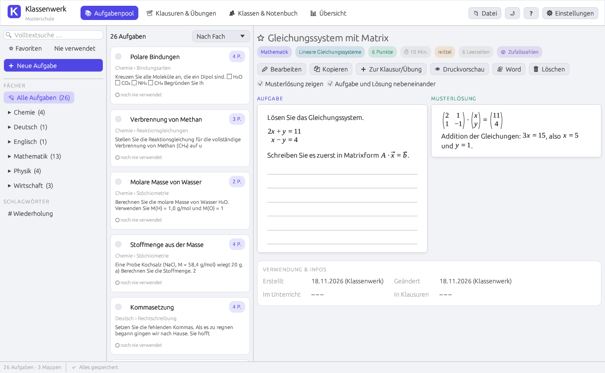
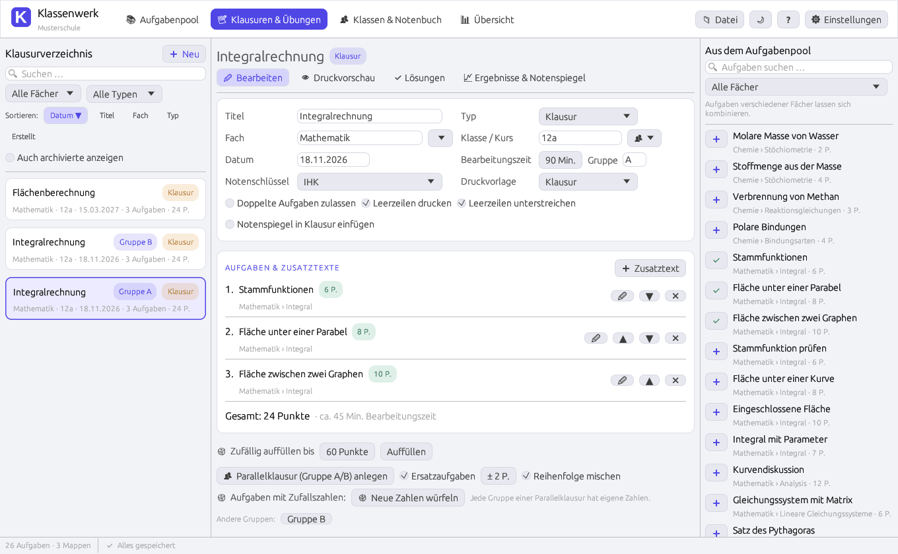
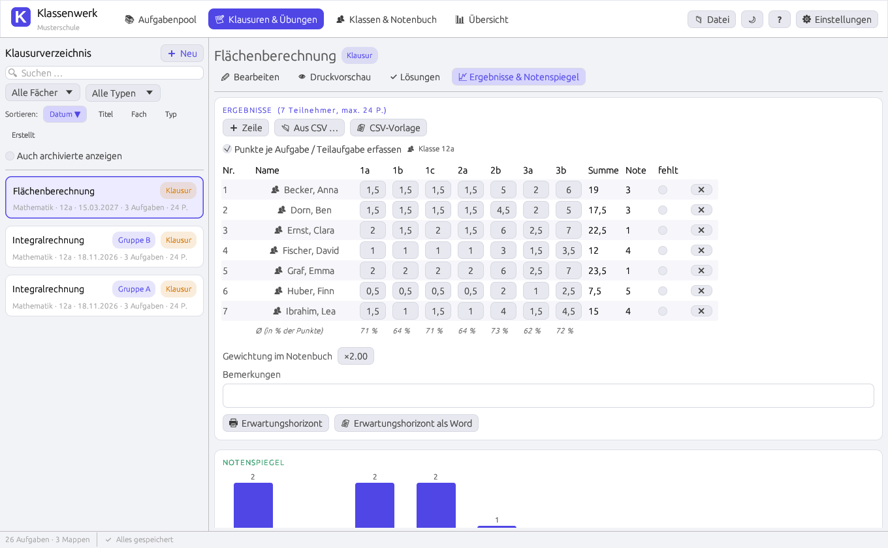
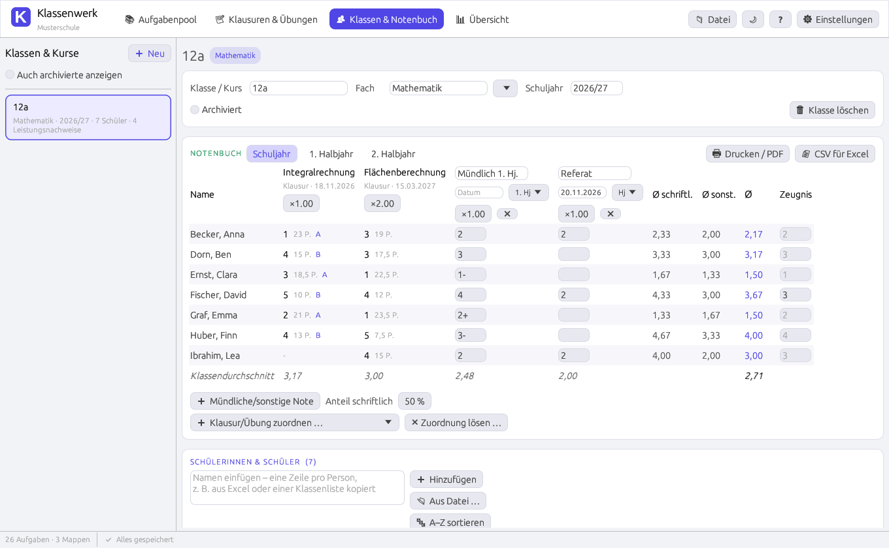
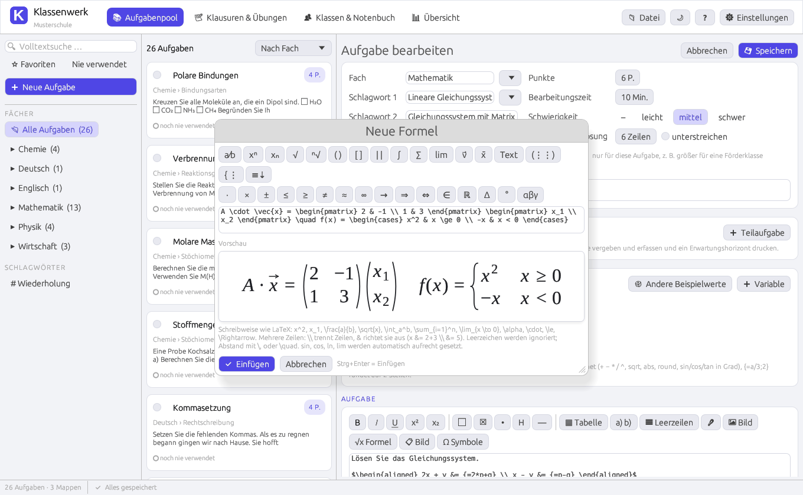
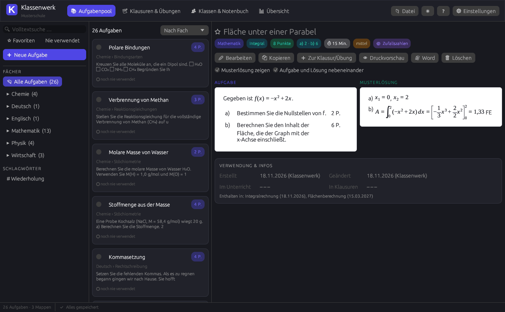

# Klassenwerk

Aufgabendatenbank, Klausurplaner und Notenbuch für Lehrkräfte – ein moderner Neubau von KlasseDozent 4.8, geschrieben in Rust mit egui. Läuft unter Windows, Linux und macOS.



**Funktionen:** Aufgaben mit Musterlösungen, Teilaufgaben und Zufallszahlen (jede Gruppe bekommt andere Zahlen) sammeln, Klausuren und Übungen zusammenstellen (auch als Parallelklausur Gruppe A/B), mit Formeleditor (auch Matrizen und mehrzeilige Rechnungen), Notenschlüssel, Notenspiegel-Diagramm und Erwartungshorizont drucken oder als Word-Datei speichern, Punkte je Teilaufgabe erfassen oder aus Excel einlesen, im Notenbuch Klausuren und mündliche Noten je Halbjahr zur Zeugnisnote verrechnen, mit Rechtschreibprüfung im Editor. Neue Versionen findet und installiert Klassenwerk auf Wunsch selbst. Auf Wunsch arbeitet ein KI-Assistent über MCP mit, ohne Zugriff auf Schülerdaten. Einzelheiten stehen in [CHANGELOG.md](CHANGELOG.md).

## Bilder

| Klausur zusammenstellen, Gruppe A/B | Ergebnisse je Teilaufgabe |
|---|---|
|  |  |
| **Notenbuch mit mündlichen Noten und Zeugnisnote** | **Formeleditor mit Matrix und Fallunterscheidung** |
|  |  |
| **Dunkles Design** | |
|  | |

Die Namen in den Bildern sind erfunden. Die Beispielaufgaben, die Klassenwerk beim ersten Start mitbringt, sind eigens für das Projekt geschrieben und wie das Programm gemeinfrei.

## Bauen

```bash
cd app
cargo build --release     # Programm: app/target/release/Klassenwerk(.exe)
cargo test
```

Pakete: `packaging/linux/build-linux.sh` (Linux), `packaging/macos/build-macos.sh` (auf einem Mac) oder der GitHub-Bauauftrag `.github/workflows/build.yml`, der alle drei Systeme baut.

## KI-Assistent

`Klassenwerk --mcp` startet den MCP-Server. Einrichten lässt er sich in Klassenwerk unter Einstellungen → „✦ KI-Assistent“ (Claude Desktop, Claude Code).

## Lizenz

Klassenwerk ist gemeinfrei ([CC0 1.0](LICENSE)): Jeder darf es ohne Bedingungen nutzen, verändern und weitergeben, auch kommerziell. Wer es weiterverwendet, wird um einen Hinweis auf das Projekt gebeten; das ist aber keine Pflicht.

Klassenwerk wurde mit Claude (Anthropic) entwickelt, als KI-gestützter Neubau nach dem Vorbild von KlasseDozent. Deshalb beansprucht niemand ein Urheberrecht daran. Die Lizenzen der verwendeten Bibliotheken und Schriften stehen in [THIRD_PARTY_LICENSES.txt](THIRD_PARTY_LICENSES.txt).

## Dokumentation

- [docs/PROJEKT_ZUSAMMENFASSUNG.md](docs/PROJEKT_ZUSAMMENFASSUNG.md): Aufbau, Bauen und Testen, offene Punkte, Ideen
- [docs/REGELN.md](docs/REGELN.md): Regeln für Notenschlüssel und Druck, Datenfelder des XML-Formats
